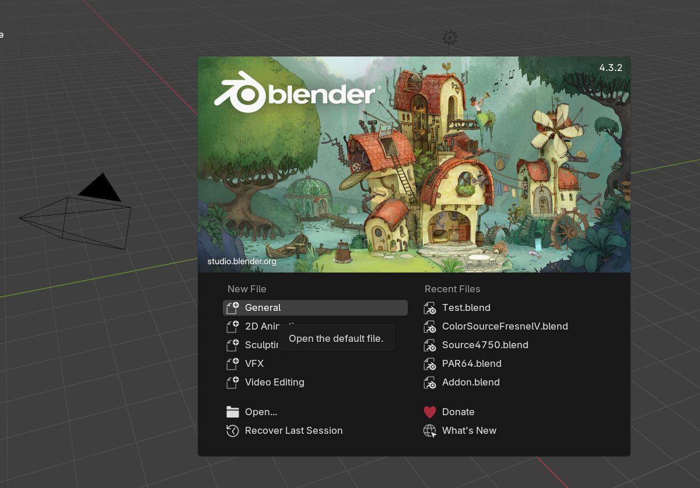
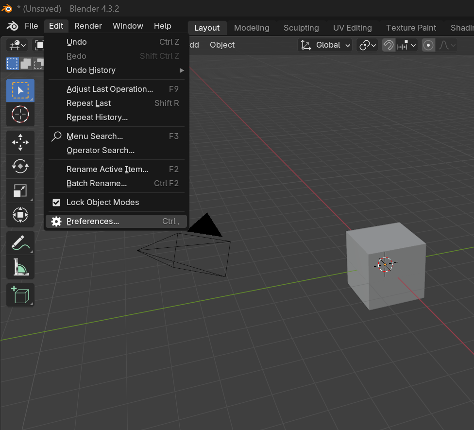
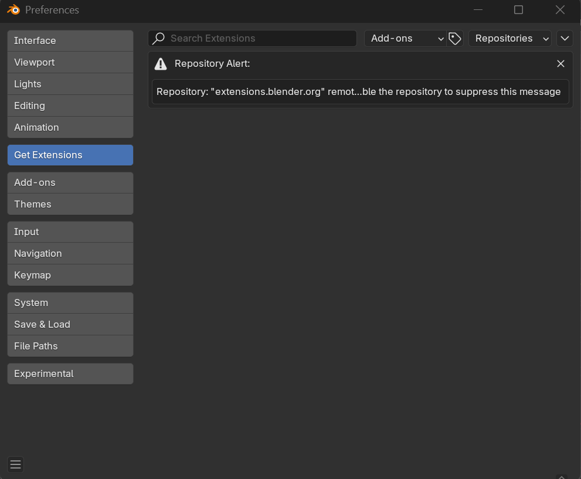
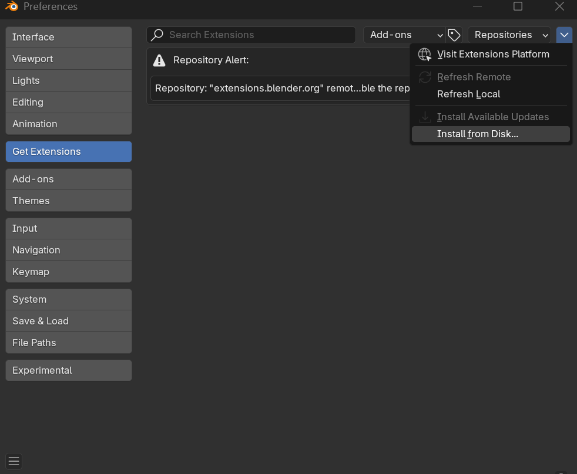
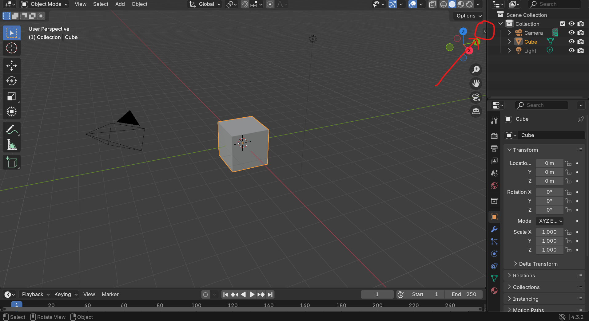
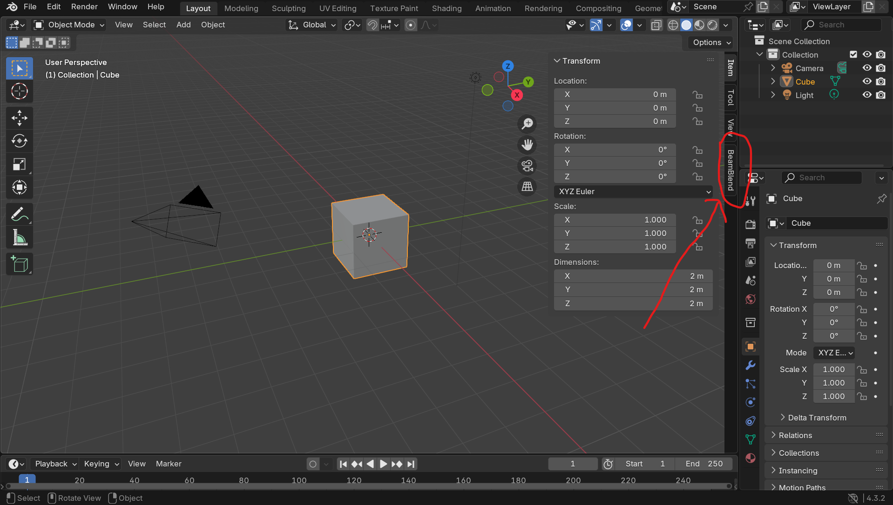

# BeamBlend

BeamBlend is a lighting previsualization Blender add-on for live theater, focusing on ease of use and accessibility for nonprofit, community, and educational organizations. Features of BeamBlend include the following:

- Fixture Library (Source 4 750, PAR 64, ColorSource Fresnel V)
- Customizable Proscenium Stage Plot
- Cue List Creator

## Project Status
The initial release is out now! Download it [here](https://github.com/alyssa-greenwell/BeamBlend/releases/tag/v1.0.0).

## Installation
To install the add-on to Blender, follow these steps:
1. Download the most recent release of the add-on [here](https://github.com/alyssa-greenwell/BeamBlend/releases/tag/v1.0.0). Take note of where it downloaded to. Important: Do not unzip the file.
2. Open a new Blender file.

   

3. Go to Edit > Preferences.

   
   
4. In the Preferences window, select "Get Extensions" from the left-hand side.

   

5. In the top right corner of the Preferences window, there is a dropdown arrow. Click it, and select "Install from Disk..."

   

6. In the window that pops up, navigate to the folder where the addon was downloaded to in the first step, and select the zip file. Then click "Install from Disk".
7. Now the add-on should be installed. To make sure it has correctly installed and to begin using it, click the arrow on the left-hand side of the screen to open the 3D Viewport, as shown below:

   

8. If the add-on is correctly installed, you should see a "Beamblend" tab on the side. Click on it to begin using Beamblend!

   

## Prerequisites
This project requires [Blender](https://www.blender.org/download/) version 4.3.2 or higher to be installed.

## Contributing
To submit a bug report or enhancement suggestion, or to contribute to this project, please read the [Contributing](CONTRIBUTING.md) file.

## License
This project is licensed under the MIT License - see the [LICENSE](LICENSE) file for details
