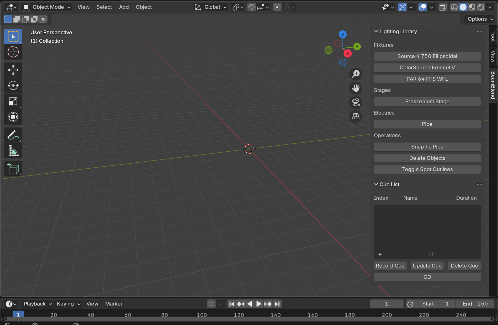
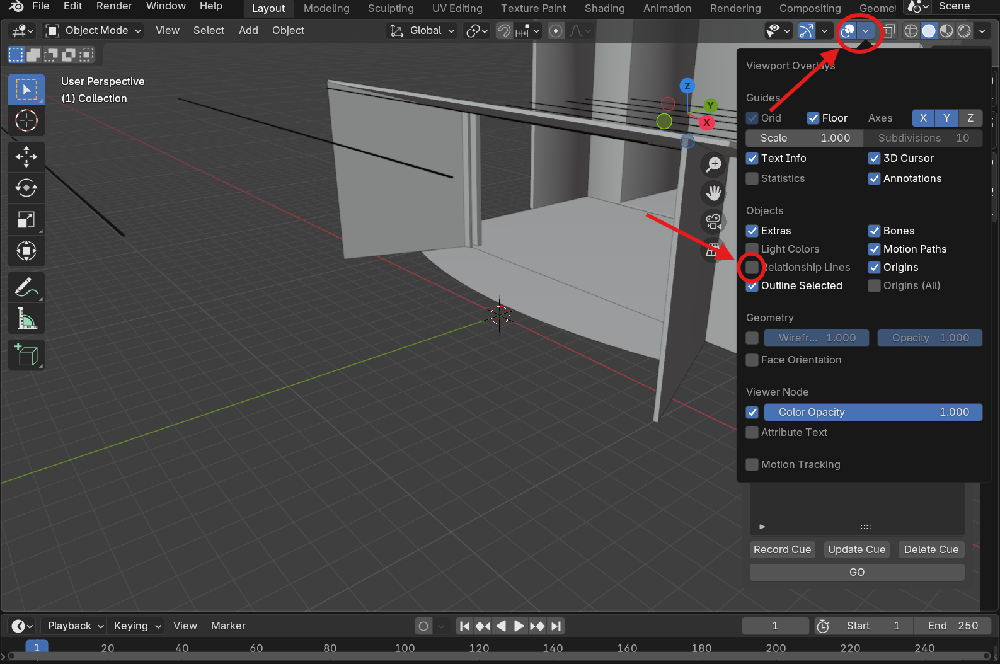
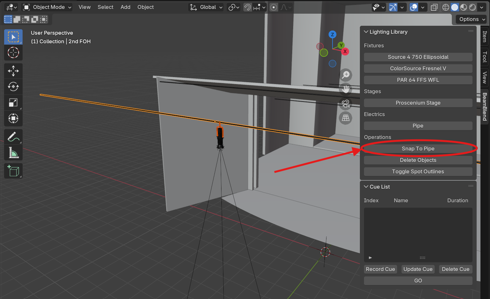
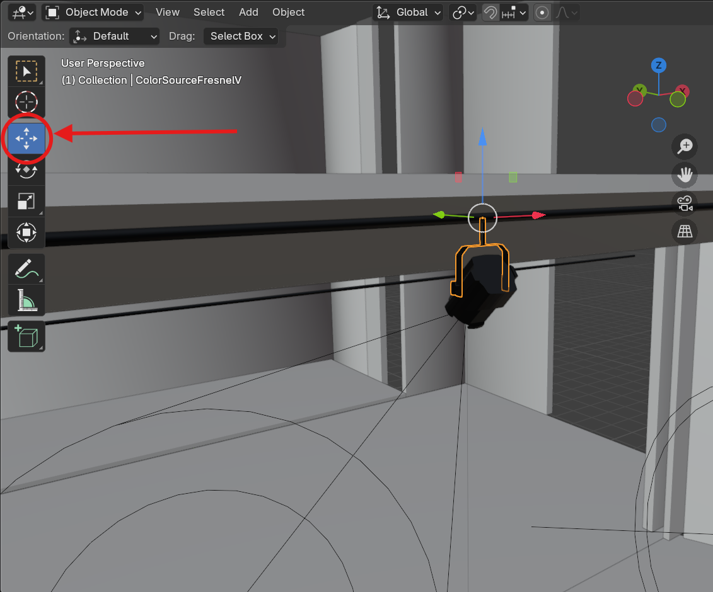
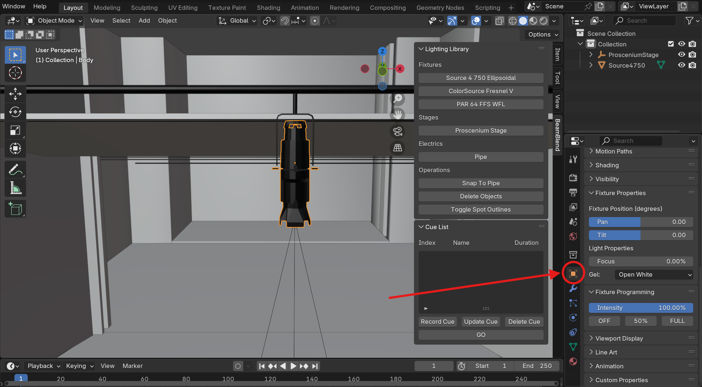
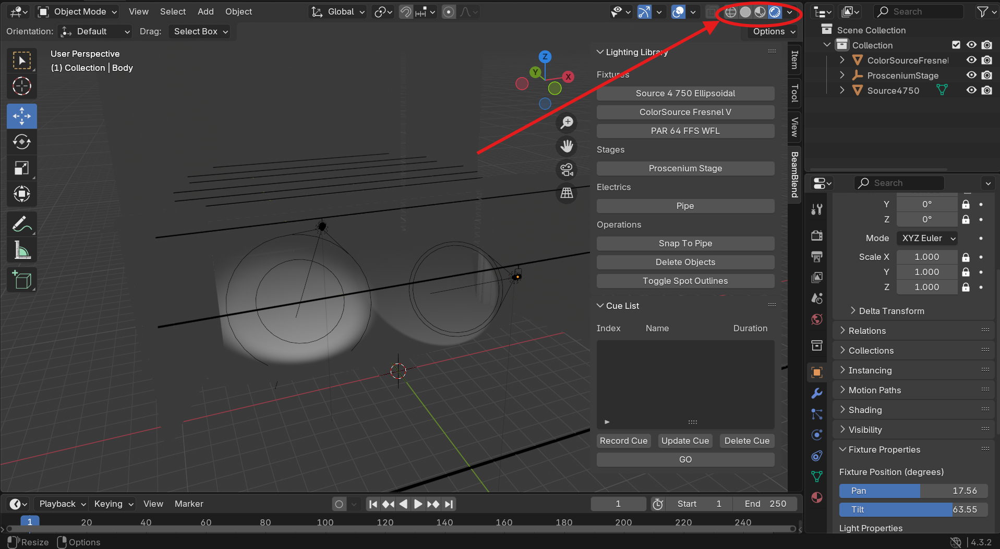
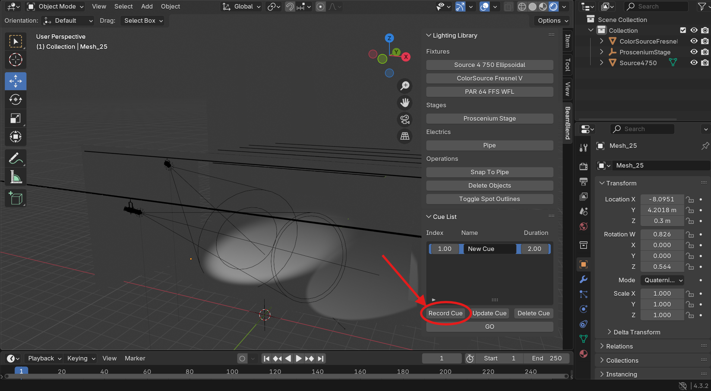
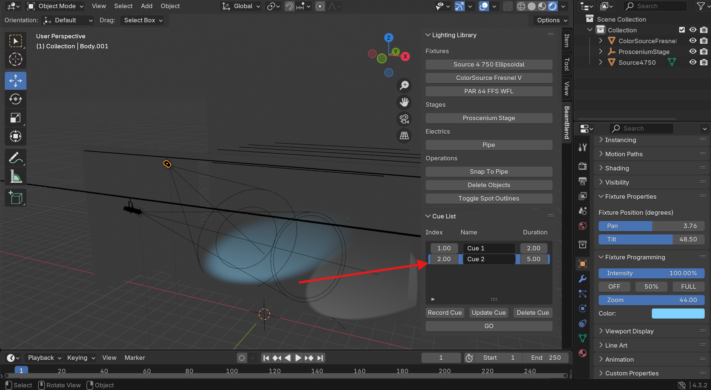
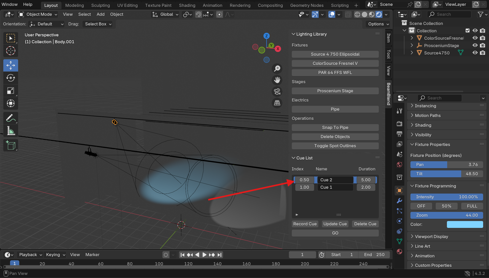

# BeamBlend

BeamBlend is a lighting previsualization Blender add-on for live theater, focusing on ease of use and accessibility for nonprofit, community, and educational organizations. Features of BeamBlend include the following:

- Fixture Library (Source 4 750, PAR 64, ColorSource Fresnel V)
- Customizable Proscenium Stage Plot
- Cue List Creator

## Project Status
The initial release is out now! Download it [here](https://github.com/alyssa-greenwell/BeamBlend/releases/tag/v1.0.0).

## Prerequisites
This project requires [Blender](https://www.blender.org/download/) version 4.3.2 or higher to be installed.

## Installation
To install the add-on to Blender, follow these steps:
1. Download the most recent release of the add-on [here](https://github.com/alyssa-greenwell/BeamBlend/releases/tag/v1.0.0). Take note of where it downloaded to. Important: Do not unzip the file.
2. Open a new Blender file.

   

3. Go to Edit > Preferences.

   
   
4. In the Preferences window, select "Get Extensions" from the left-hand side.

   

5. In the top right corner of the Preferences window, there is a dropdown arrow. Click it, and select "Install from Disk..."

   

6. In the window that pops up, navigate to the folder where the addon was downloaded to in the first step, and select the zip file. Then click "Install from Disk".
7. Now the add-on should be installed. To make sure it has correctly installed and to begin using it, click the arrow on the left-hand side of the screen to open the 3D Viewport, as shown below:

   

8. If the add-on is correctly installed, you should see a "BeamBlend" tab on the side. Click on it to begin using BeamBlend!

   

## Using BeamBlend

The following is some of the basics to getting started using BeamBlend. I will be covering some of the features of this add-on, but I will **not** be providing a comprehensive intro to Blender. I will only cover a Blender function if it is directly relevant to BeamBlend. There are several resources online that can help you with Blender basics if you are new to the program. If you've never used Blender before, I suggest watching this [Intro to 3D Navigation in Blender](https://www.youtube.com/watch?v=i8wO5PEDO1c) by CG Cookie on YouTube before jumping into BeamBlend. This should be enough to get started, but if you're interested in more in-depth videos on how to use Blender, you can view CG Cookie's full [Blender Beginner Course](https://www.youtube.com/watch?v=iYKrLnOwPBM&list=PL3GeP3YLZn5gZhJhyIQPKoz9Yrs9oKU9R).

### Getting Started

The first thing you will want to do if you haven't already is open the 3D Viewport on the right side of the screen and open the "BeamBlend" tab. (See steps 7 and 8 of Installation above for instructions on how to do that). I also recommend deleting any objects that are in the scene by default. You should see a screen that looks something like the following:

The first thing we will want is a stage. Select a stage from the Lighting Library tab to spawn one in. You should see a stage appear on the screen.

Optional but recommended step: Go to Viewport Overlays and uncheck "Relationship Lines". This will make your stage look a lot cleaner.

Now we want to spawn in a light. Select a light from the lighting library to spawn one in. Then, with the newly spawned light selected, shift click any electric pipe on the stage and click "Snap to Pipe" to move the light fixture onto the nearest point on the pipe.

If you want to adjust the position of the fixture, select the **yoke** of the fixture.

Blender tip: You can click the "Move" icon on the left side of the screen to bring up arrows that will move the fixture. You can also press 'G' to move an object freely, or press 'GX', 'GY', or 'GZ' to move an object about an axis. I recommend using 'GX' to move a fixture along a pipe, as most pipes spawned in with stages are set along the X axis.

Once you have your fixture in place, it is time to start messing with some fixture properties. Select any part of the fixture and look to the properties window in the bottom right corner. Ensure that you are on the Object Properties tab (the orange square) and scroll down to find Fixture Properties and Fixture Programmables.

Note on the two panels: Fixture Properties represents the physical properties of the fixture. These are the things that would be manually set on the fixture before the show or during a hang and focus. These things will **not** be affected by cues. If they are changed, the changes are reflected in every cue. Fixture Programmables represents the things that are controlled by a board, i.e. intensity and any DMX properties the light fixture has. These properties are affected by cues.

At this stage, you might notice that we cannot actually see the light! Blender does not render light in its default view. In the top right corner of the scene, you will see different shading options. By selecting the fourth option, Viewport Shading, we will be able to see our lights when pointed onto the stage.

### Using the Cue List

In the bottom right corner of the scene, just to the left of the properties window, you will find your Cue List. The following are some basic operations of the Cue List.

The first thing you want to do is make a cue. Create a look with your lights on the stage, then hit "Record Cue" to create a new cue with that look.

Now, if you make any changes to the look on the scene, you can save them by either hitting "Update Cue" to change the look of the current selected cue to the new look, or you can hit "Record Cue" again to create a new cue with this new look.

Note: This program currently utilizes Cue Only mode. This means that changes made to cues are independent and are not propogated forward through the cue list. In the future, I plan to add a Tracking mode to BeamBlend, but it is not available at this time.

Another noteworthy feature of the cue list is the index. The cue list is always sorted by ascending index. If the index of a cue is changed, its position in the cue list will also be changed.

This concludes the basics of BeamBlend. I encourage you to explore the program further yourself!

## Contributing
To submit a bug report or enhancement suggestion, or to contribute to this project, please read the [Contributing](CONTRIBUTING.md) file.

## License
This project is licensed under the MIT License - see the [LICENSE](LICENSE) file for details
